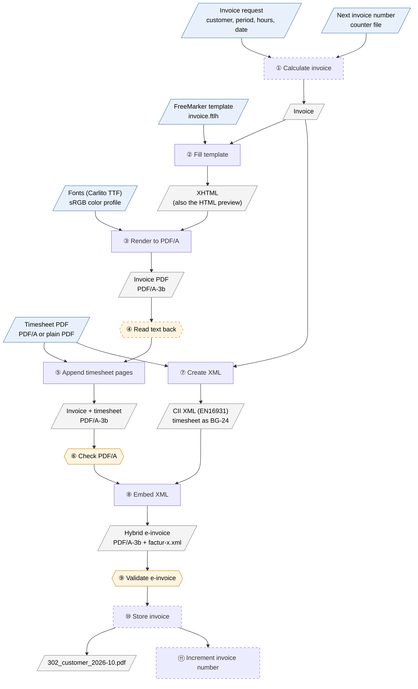

# E-Invoice Generator

[](https://github.com/sdingel/e-invoice-generator/actions/workflows/build.yml)

Command-line tool for freelancers that creates monthly invoices as hybrid **ZUGFeRD e-invoices**
(PDF/A-3 with embedded XML, profile EN16931), including a timesheet.

> **Status:** usable from the command line (dialog), steps ① to ⑪ implemented. Plan and decisions (German):
> [`PLAN.md`](PLAN.md).

## How an invoice is generated

Each numbered processing step has one interface with a defined input and output (signatures in
[`PLAN.md`](PLAN.md), section 8). The diagram shows the data flow; the proof of concept
(`de.steffendingel.einvoicegenerator.poc.PocMain`) implemented steps ② to ⑨ except ④; the application
now implements all steps (`InvoiceService`).

Legend: blue parallelograms are inputs, grey parallelograms are intermediate results and output,
rectangles are processing steps, hexagons are checks that abort on failure. Dashed shapes are planned
but not part of the proof of concept yet.



| Step | Interface | Library | Input → output |
|---|---|---|---|
| ① Calculate invoice | – (class `InvoiceCalculator`) | – | invoice request, invoice number → invoice |
| ② Fill template | `InvoiceHtmlRenderer` | [FreeMarker](https://github.com/apache/freemarker) | invoice, attachment labels → XHTML |
| ③ Render to PDF/A | `HtmlToPdfConverter` | [openhtmltopdf](https://github.com/openhtmltopdf/openhtmltopdf) | XHTML → invoice PDF (PDF/A-3b, fonts embedded) |
| ④ Read text back | `PdfTextVerifier` | [PDFBox](https://github.com/apache/pdfbox) | PDF, expected texts → valid / problems |
| ⑤ Append timesheet pages | `PdfPageAppender` | [PDFBox](https://github.com/apache/pdfbox) | invoice PDF, timesheet PDFs → merged PDF |
| ⑥ Check PDF/A | `PdfAValidator` | [veraPDF](https://github.com/veraPDF/veraPDF-library) | PDF → valid / problems |
| ⑦ Create XML | `EInvoiceXmlGenerator` | [Mustang](https://github.com/ZUGFeRD/mustangproject) | invoice, timesheets → CII XML |
| ⑧ Embed XML | `EInvoiceXmlEmbedder` | [Mustang](https://github.com/ZUGFeRD/mustangproject) | merged PDF, XML → hybrid e-invoice |
| ⑨ Validate e-invoice | `EInvoiceValidator` | [Mustang](https://github.com/ZUGFeRD/mustangproject) validator (incl. veraPDF) | e-invoice → valid / problems |
| ⑩ Store invoice | `InvoiceArchive` | – | invoice, e-invoice → file in the output directory |
| ⑪ Increment invoice number | `InvoiceNumberSource` | – | used number → counter file |

`InvoiceService` runs the steps in this order and aborts at the first failed check.

Notes:

- The timesheet does **not** have to be PDF/A itself; what counts is the merged PDF (⑥). Right after
  the timesheet is entered, ⑤ and ⑥ run on trial to report problems early.
- The timesheet appears twice: as visible pages (⑤) and as an attachment in the XML (⑦, BG-24), so it
  also reaches recipients that only process the XML.
- ④ exists because openhtmltopdf silently drops all text in PDF/A mode when no font is available, and
  veraPDF still reports the empty page as compliant.
- ⑤ must run before ⑧: appending pages after embedding the XML would break the PDF/A metadata.

## Installation

Requirements: Java 17 or newer.

1. Download the latest build: on the [Actions page](https://github.com/sdingel/e-invoice-generator/actions/workflows/build.yml),
   open a successful run of `main` and download the artifact **e-invoice-generator** (a ZIP file), or build it
   yourself (see below).
2. Unpack it into a directory of your choice. It contains `e-invoice-generator.jar` and the start scripts
   `e-invoice-generator` (Linux, WSL, macOS) and `e-invoice-generator.cmd` (Windows). The JAR and the scripts
   must stay in the same directory.
3. On Linux/WSL/macOS make the script executable: `chmod +x e-invoice-generator` (ZIP files do not keep this
   permission). Optionally put the directory on your `PATH`.
4. Create the configuration in `~/rechnungen/config` (see [Configuration](#configuration)).

```sh
e-invoice-generator                       # Linux, WSL, macOS
e-invoice-generator.cmd                   # Windows
java -jar e-invoice-generator.jar         # without the scripts
e-invoice-generator --config ~/my-config  # other configuration directory
```

The dialog asks for customer, invoice date, billing period (month), hours and the timesheet (Tab completes
file names), shows a summary and creates the e-invoice after confirmation, reporting each step ① to ⑪.
Exit code: 0 invoice created, 1 error, 2 aborted.

## Build

Requirements: Java 17 or newer, Maven 3.9.

```sh
mvn verify    # build, run the tests and create target/e-invoice-generator.jar with the start scripts

# run without building the JAR
mvn -q compile exec:java -Dexec.mainClass=de.steffendingel.einvoicegenerator.App
mvn -q compile exec:java -Dexec.mainClass=de.steffendingel.einvoicegenerator.App -Dexec.args="--config ~/my-config"
```

Tests named `*IT` run against the finished JAR after packaging (`mvn verify`, not `mvn test`).

Proof of concept (throwaway), output in `target/poc/`:

```sh
mvn compile exec:java -Dexec.mainClass=de.steffendingel.einvoicegenerator.poc.PocMain
mvn compile exec:java -Dexec.mainClass=de.steffendingel.einvoicegenerator.poc.PocMain \
    -Dexec.args="target/poc /path/to/timesheet.pdf"
```

## Configuration

The tool reads two YAML files: `settings.yaml` (seller data, output directory, optional logo and
template) and `customers.yaml` (customers with hourly rate, payment term, line item text and free
placeholders for the template). Commented examples with fictitious data are in
[`examples/config/`](examples/config/).

The next invoice number is read from the file `invoice-counter` next to `settings.yaml`; it must
exist (e.g. with the content `302`). Invoices are stored in the output directory under a file name built
from a template (setting `fileName`), by default e.g.
`2026-11-09 Max Mustermann Beispielkunde Rechnung 304 für 2026-10.pdf`.

## Fonts and logo

The template uses [Carlito](https://github.com/googlefonts/carlito), which is metric-compatible with
Calibri and licensed under the SIL Open Font License (see
[`src/main/resources/fonts/OFL-Carlito.txt`](src/main/resources/fonts/OFL-Carlito.txt)).

Carlito is the only font available for templates; it is also registered under the names `Calibri` and
`sans-serif`. Text in any other font family would be left out of the PDF, so step ④ rejects the invoice
in that case.

A logo can be a PDF (stays a vector graphic), PNG or JPEG; SVG is not supported. An EPS logo can be
converted to PDF first, e.g. with Ghostscript: `ps2pdf -dEPSCrop logo.eps logo.pdf` (use RGB colors,
not CMYK).
