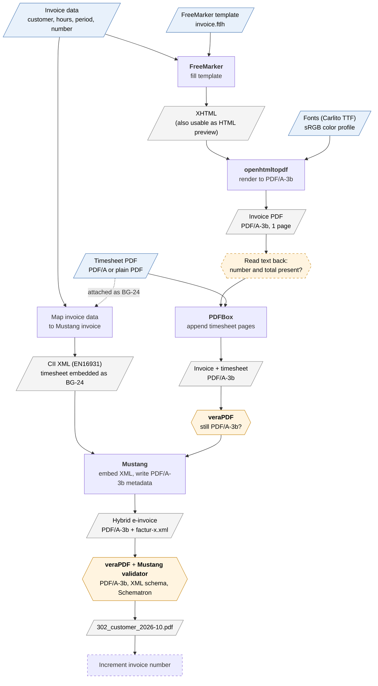

# E-Invoice Generator

Command-line tool for freelancers that creates monthly invoices as hybrid **ZUGFeRD e-invoices**
(PDF/A-3 with embedded XML, profile EN16931), including a timesheet.

> **Status:** proof of concept done, implementation not started yet. Plan and decisions (German):
> [`PLAN.md`](PLAN.md).

## How an invoice is generated

The diagram shows the data flow as implemented in the proof of concept
(`de.steffendingel.einvoicegenerator.poc.PocMain`).

Legend: blue parallelograms are inputs, grey parallelograms are intermediate results and output,
rectangles are processing steps, hexagons are checks that abort on failure. Dashed shapes are planned
but not part of the proof of concept yet.



| Step | Interface | Library | Result |
|---|---|---|---|
| Fill the template with the invoice data | `InvoiceDocumentRenderer` | FreeMarker 2.3.35 | XHTML (amounts and dates already formatted in Java) |
| Render XHTML to PDF | `InvoiceDocumentRenderer` | openhtmltopdf 1.1.100 (PDFBox 3) | Invoice page as PDF/A-3b, fonts embedded |
| Append the timesheet pages | `EInvoiceWriter` | PDFBox 3.0.8 | One PDF; output intent and metadata of the invoice apply to all pages |
| Check the merged PDF | `PdfAValidator` (used by `EInvoiceWriter`) | veraPDF (via Mustang validator) | Must still be PDF/A-3b, otherwise abort |
| Create and embed the XML | `EInvoiceWriter` | Mustang 2.26.0 | CII XML (EN16931) with the timesheet as BG-24, PDF/A-3b metadata |
| Validate the result | `EInvoiceValidator` | veraPDF + Mustang validator | PDF/A-3b, XML schema and Schematron rules |

Storing the file and incrementing the invoice number are done by `InvoiceArchive` and
`InvoiceNumberSource`; `InvoiceService` runs the steps. Signatures: [`PLAN.md`](PLAN.md), section 8.

Notes:

- The timesheet does **not** have to be PDF/A itself; what counts is the merged PDF.
- The timesheet appears twice: as visible pages and as an attachment in the XML (BG-24), so it also
  reaches recipients that only process the XML.
- The text read-back check exists because openhtmltopdf silently drops all text in PDF/A mode when
  no font is available, and veraPDF still reports the empty page as compliant.

## Build and run

Requirements: Java 21, Maven 3.9.

```sh
mvn compile

# proof of concept, output in target/poc/
mvn compile exec:java -Dexec.mainClass=de.steffendingel.einvoicegenerator.poc.PocMain

# with your own timesheet
mvn compile exec:java -Dexec.mainClass=de.steffendingel.einvoicegenerator.poc.PocMain \
    -Dexec.args="target/poc /path/to/timesheet.pdf"
```

## Fonts

The template uses [Carlito](https://github.com/googlefonts/carlito), which is metric-compatible with
Calibri and licensed under the SIL Open Font License (see
[`src/main/resources/fonts/OFL-Carlito.txt`](src/main/resources/fonts/OFL-Carlito.txt)).
