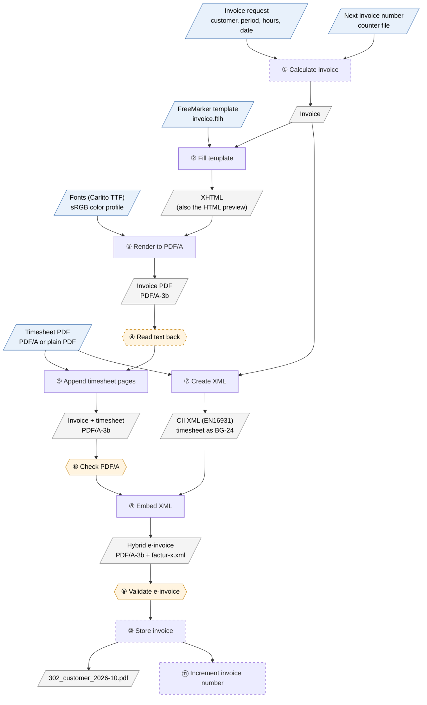

# E-Invoice Generator

[](https://github.com/sdingel/e-invoice-generator/actions/workflows/build.yml)

Command-line tool for freelancers that creates monthly invoices as hybrid **ZUGFeRD e-invoices**
(PDF/A-3 with embedded XML, profile EN16931), including a timesheet.

> **Status:** proof of concept done, implementation not started yet. Plan and decisions (German):
> [`PLAN.md`](PLAN.md).

## How an invoice is generated

Each numbered processing step has one interface with a defined input and output (signatures in
[`PLAN.md`](PLAN.md), section 8). The diagram shows the data flow; the proof of concept
(`de.steffendingel.einvoicegenerator.poc.PocMain`) implements steps ② to ⑨ except ④.

Legend: blue parallelograms are inputs, grey parallelograms are intermediate results and output,
rectangles are processing steps, hexagons are checks that abort on failure. Dashed shapes are planned
but not part of the proof of concept yet.



| Step | Interface | Library | Input → output |
|---|---|---|---|
| ① Calculate invoice | – (class `InvoiceCalculator`) | – | invoice request, invoice number → invoice |
| ② Fill template | `InvoiceHtmlRenderer` | [FreeMarker](https://github.com/apache/freemarker) | invoice, attachment labels → XHTML |
| ③ Render to PDF/A | `HtmlToPdfConverter` | [openhtmltopdf](https://github.com/openhtmltopdf/openhtmltopdf) | XHTML → invoice PDF (PDF/A-3b, fonts embedded) |
| ④ Read text back | `PdfTextVerifier` | [PDFBox](https://github.com/apache/pdfbox) | PDF, expected texts → valid / problems |
| ⑤ Append timesheet pages | `PdfPageAppender` | [PDFBox](https://github.com/apache/pdfbox) | invoice PDF, timesheet PDFs → merged PDF |
| ⑥ Check PDF/A | `PdfAValidator` | [veraPDF](https://github.com/veraPDF/veraPDF-library) | PDF → valid / problems |
| ⑦ Create XML | `EInvoiceXmlGenerator` | [Mustang](https://github.com/ZUGFeRD/mustangproject) | invoice, timesheets → CII XML |
| ⑧ Embed XML | `EInvoiceXmlEmbedder` | [Mustang](https://github.com/ZUGFeRD/mustangproject) | merged PDF, XML → hybrid e-invoice |
| ⑨ Validate e-invoice | `EInvoiceValidator` | [Mustang](https://github.com/ZUGFeRD/mustangproject) validator (incl. veraPDF) | e-invoice → valid / problems |
| ⑩ Store invoice | `InvoiceArchive` | – | invoice, e-invoice → file in the output directory |
| ⑪ Increment invoice number | `InvoiceNumberSource` | – | used number → counter file |

`InvoiceService` runs the steps in this order and aborts at the first failed check.

Notes:

- The timesheet does **not** have to be PDF/A itself; what counts is the merged PDF (⑥). Right after
  the timesheet is entered, ⑤ and ⑥ run on trial to report problems early.
- The timesheet appears twice: as visible pages (⑤) and as an attachment in the XML (⑦, BG-24), so it
  also reaches recipients that only process the XML.
- ④ exists because openhtmltopdf silently drops all text in PDF/A mode when no font is available, and
  veraPDF still reports the empty page as compliant.
- ⑤ must run before ⑧: appending pages after embedding the XML would break the PDF/A metadata.

## Build and run

Requirements: Java 21, Maven 3.9.

```sh
mvn verify    # build and run the tests

# proof of concept, output in target/poc/
mvn compile exec:java -Dexec.mainClass=de.steffendingel.einvoicegenerator.poc.PocMain

# with your own timesheet
mvn compile exec:java -Dexec.mainClass=de.steffendingel.einvoicegenerator.poc.PocMain \
    -Dexec.args="target/poc /path/to/timesheet.pdf"
```

## Fonts

The template uses [Carlito](https://github.com/googlefonts/carlito), which is metric-compatible with
Calibri and licensed under the SIL Open Font License (see
[`src/main/resources/fonts/OFL-Carlito.txt`](src/main/resources/fonts/OFL-Carlito.txt)).
