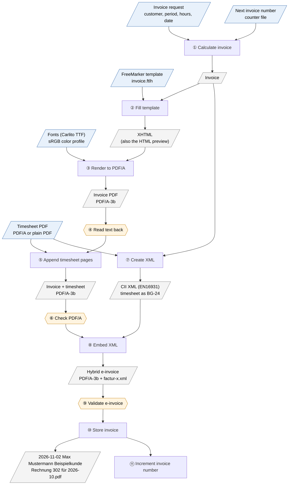

# E-Invoice Generator

[](https://github.com/sdingel/e-invoice-generator/actions/workflows/build.yml)

Command-line tool for freelancers that creates monthly invoices as hybrid **ZUGFeRD e-invoices**
(PDF/A-3 with embedded XML, profile EN16931), including a timesheet.

> **Status:** usable from the command line (dialog), steps ① to ⑪ implemented. Planning happens in
> [GitHub issues](https://github.com/sdingel/e-invoice-generator/issues); how the tool is built and why:
> [`docs/architecture.md`](docs/architecture.md).

## Scope and limitations

The tool is made for one use case: a freelancer in Germany who bills German business customers by the
hour, once a month.

- **Customers:** German B2B customers only; no public sector customers (XRechnung), no customers abroad.
- **Format:** ZUGFeRD, profile **EN 16931** (Comfort). Anyone who only wants a PDF can ignore the
  embedded XML.
- **VAT:** always **19 %**, category `S` (no small business exemption, no reverse charge).
- **One line item** per invoice: quantity = hours (unit `HUR`), price = the customer's hourly rate, a
  fixed text per customer. Hours may have decimals.
- **Billing period:** one month, by default the month before the invoice date; it is required on the
  invoice and in the XML.
- **Invoice numbers:** purely numeric and consecutive across years (e.g. `302`).
- **Payment:** SEPA credit transfer (code `58`) with IBAN and BIC; due date = invoice date + payment
  term in days (not moved to a working day).
- **Amounts:** rounded commercially to two decimals.
- **Seller:** needs a VAT ID or a tax number (at least one).
- **Language:** the invoice is German (template, file name, amounts and dates); the console dialog is
  English.

## How an invoice is generated

Each numbered processing step has one interface with a defined input and output (details in
[`docs/architecture.md`](docs/architecture.md)). The diagram shows the data flow; `InvoiceService` runs
the steps.

Legend: blue parallelograms are inputs, grey parallelograms are intermediate results and output,
rectangles are processing steps, hexagons are checks that abort on failure.



| Step | Interface | Library | Input → output |
|---|---|---|---|
| ① Calculate invoice | – (class `InvoiceCalculator`) | – | invoice request, invoice number → invoice |
| ② Fill template | `InvoiceHtmlRenderer` | [FreeMarker](https://github.com/apache/freemarker) | invoice, attachment labels → XHTML |
| ③ Render to PDF/A | `HtmlToPdfConverter` | [openhtmltopdf](https://github.com/openhtmltopdf/openhtmltopdf) | XHTML → invoice PDF (PDF/A-3b, fonts embedded) |
| ④ Read text back | `PdfTextVerifier` | [PDFBox](https://github.com/apache/pdfbox) | PDF, expected texts → valid / problems |
| ⑤ Append timesheet pages | `PdfPageAppender` | [PDFBox](https://github.com/apache/pdfbox) | invoice PDF, timesheet PDFs → merged PDF |
| ⑥ Check PDF/A | `PdfAValidator` | [veraPDF](https://github.com/veraPDF/veraPDF-library) | PDF → valid / problems |
| ⑦ Create XML | `EInvoiceXmlGenerator` | [Mustang](https://github.com/ZUGFeRD/mustangproject) | invoice, timesheets → CII XML |
| ⑧ Embed XML | `EInvoiceXmlEmbedder` | [Mustang](https://github.com/ZUGFeRD/mustangproject) | merged PDF, XML → hybrid e-invoice |
| ⑨ Validate e-invoice | `EInvoiceValidator` | [Mustang](https://github.com/ZUGFeRD/mustangproject) validator (incl. veraPDF) | e-invoice → valid / problems |
| ⑩ Store invoice | `InvoiceArchive` | – | invoice, e-invoice → file in the output directory |
| ⑪ Increment invoice number | `InvoiceNumberSource` | – | used number → counter file |

`InvoiceService` runs the steps in this order and aborts at the first failed check.

Notes:

- The timesheet does **not** have to be PDF/A itself; what counts is the merged PDF (⑥). Right after
  the timesheet is entered, ⑤ and ⑥ run on trial to report problems early.
- The timesheet appears twice: as visible pages (⑤) and as an attachment in the XML (⑦, BG-24), so it
  also reaches recipients that only process the XML.
- ④ exists because openhtmltopdf silently drops all text in PDF/A mode when no font is available, and
  veraPDF still reports the empty page as compliant.
- ⑤ must run before ⑧: appending pages after embedding the XML would break the PDF/A metadata.

## Installation

Requirements: Java 17 or newer.

1. Download the latest build: on the [Actions page](https://github.com/sdingel/e-invoice-generator/actions/workflows/build.yml),
   open a successful run of `main` and download the artifact **e-invoice-generator** (a ZIP file), or build it
   yourself (see below).
2. Unpack it into a directory of your choice. It contains the start scripts `e-invoice-generator` (Linux,
   WSL, macOS) and `e-invoice-generator.cmd` (Windows) and the directory `lib/` with the JAR of the tool
   (`e-invoice-generator-<version>.jar`) and the libraries. The scripts and `lib/` must stay in the same
   directory, and the JARs must stay together in `lib/`: the tool finds its libraries only next to its own JAR.
3. On Linux/WSL/macOS make the script executable: `chmod +x e-invoice-generator` (ZIP files do not keep this
   permission). Optionally put the directory on your `PATH`.
4. Create the configuration in `~/rechnungen/config` (see [Configuration](#configuration)).

```sh
e-invoice-generator                       # Linux, WSL, macOS
e-invoice-generator.cmd                   # Windows
java -jar lib/e-invoice-generator-<version>.jar   # without the scripts
e-invoice-generator --config ~/my-config  # other configuration directory
e-invoice-generator --version             # show the version
```

The dialog asks for customer, invoice date, billing period (month), hours and the timesheet (Tab completes
file names), shows a summary and creates the e-invoice after confirmation, reporting each step ① to ⑪:

```
Customer:
  1) beispiel     Beispiel GmbH
  2) muster       Muster AG
Choice [1]:
Invoice date [14.11.2026]:
Billing period [10/2026]:
Hours: 37,5
Timesheet (PDF): ~/Downloads/nachweis.pdf
✔ Timesheet is suitable
────────────────────────────────────────────────────
Invoice no. 302 to Beispiel GmbH
Invoice date             14.11.2026
Billing period           01.10.2026 – 31.10.2026
37,50 h × 95,00 €        =    3.562,50 €
plus 19 % VAT            =      676,88 €
Total                    =    4.239,38 €
Due date                 14.12.2026
Attachment               Tätigkeitsnachweis 10/2026 (nachweis.pdf)
────────────────────────────────────────────────────
Create the invoice? [Y/n]:
✔ ① Invoice number checked
…
✔ ⑪ Invoice number incremented

Invoice created: /home/max/rechnungen/2026-11-14 Max Mustermann Beispielkunde Rechnung 302 für 2026-10.pdf
```

- Dates are entered as `DD.MM.YYYY`, the billing period as `MM/YYYY`; hours take a comma or a point.
- Exactly one timesheet per invoice. It is labelled "Tätigkeitsnachweis MM/YYYY" on the invoice and is
  checked right after it is entered (see [Timesheet](#timesheet)).
- If there is already an invoice for the same customer and month, the dialog warns and asks whether to
  continue (default: no).

Exit code: 0 invoice created, 1 error, 2 aborted.

Each invoice names the tool with its version in the PDF metadata: Producer, and Creator (shown in the
document properties of PDF viewers) and XMP CreatorTool with the project URL.

## Build

Requirements: Java 17 or newer, Maven 3.9.

```sh
mvn verify    # build, run the tests and create target/lib/ (JAR and libraries) and the start scripts in target/

# run without building the JAR
mvn -q compile exec:java -Dexec.mainClass=de.steffendingel.einvoicegenerator.App
mvn -q compile exec:java -Dexec.mainClass=de.steffendingel.einvoicegenerator.App -Dexec.args="--config ~/my-config"
```

Tests named `*IT` run against the finished JAR after packaging (`mvn verify`, not `mvn test`).

## Configuration

The configuration directory (default `~/rechnungen/config`, another one with `--config`) contains three
files. Commented examples with fictitious data are in [`examples/config/`](examples/config/).

- **`settings.yaml`:** seller data, output directory, optional logo, template and file name template.
  It contains only seller data that is also needed in the XML (name, address, VAT ID or tax number, IBAN,
  BIC, email). Display-only details such as job title, phone number, website or bank name belong in the
  template.
- **`customers.yaml`:** the customers with ID, name, optional short name (for file names), address,
  optional VAT ID and email, hourly rate (net, EUR), payment term in days, line item text, and optional
  free placeholders for the template (`fields`).
- **`invoice-counter`:** the next invoice number, e.g. `302`. It must exist; it is increased only after
  an invoice was stored.

Notes:

- Write postcodes in quotes (`zip: "01067"`), otherwise YAML drops leading zeros; the tool rejects
  unquoted postcodes.
- Unknown keys (typos) are reported with their path.
- Paths: `~/` is the home directory, relative paths are relative to the configuration file. A bare `~`
  means "empty" in YAML.

**Free placeholders (`fields`):** any key-value pairs (text) that the template uses as
`customer.fields.<key>`, e.g.
`<#if customer.fields.vertragsdatum??>gemäß unserem Vertrag vom ${customer.fields.vertragsdatum} …<#else>hiermit …</#if>`
or `${customer.fields.ansprechpartner!}` (prints nothing if the value is missing). The values are used
as they are, so write dates already in the desired format. They appear only in the PDF, not in the XML.

## Invoice template

The built-in template (`src/main/resources/templates/invoice.ftlh`) contains only example data. For your
own invoices, copy it into the configuration directory, adjust it and set `template:` in
`settings.yaml`; no new build is needed.

- It is a [FreeMarker](https://freemarker.apache.org/) template that produces XHTML (file extension
  `.ftlh`, so `&`, `<` and `>` in data are escaped).
- Available data: `invoice`, `seller`, `customer` (including `customer.fields`), `attachments` (labels
  of the timesheets), `logo` (only if set) and `format` for amounts and dates in German format, e.g.
  `${format.money(invoice.grossAmount)}`.
- **Rule:** everything that is also in the XML (names, addresses, VAT ID, tax number, IBAN, BIC, invoice
  and customer data) comes from the data; only display-only details are fixed in the template. Then the
  PDF and the XML cannot disagree.
- Relative image paths in your own template are relative to the template's directory.

## Fonts and logo

The template uses [Carlito](https://github.com/googlefonts/carlito), which is metric-compatible with
Calibri and licensed under the SIL Open Font License (see
[`src/main/resources/fonts/OFL-Carlito.txt`](src/main/resources/fonts/OFL-Carlito.txt)).

Carlito is the only font available for templates; it is also registered under the names `Calibri` and
`sans-serif`. Text in any other font family would be left out of the PDF, so step ④ rejects the invoice
in that case.

A logo (optional, `logo:` in `settings.yaml`) can be a PDF (stays a vector graphic), PNG or JPEG; SVG is
not supported. The template fixes only its height; the width follows the aspect ratio. An EPS logo can be
converted to PDF first, e.g. with Ghostscript: `ps2pdf -dEPSCrop logo.eps logo.pdf` (use RGB colors,
not CMYK).

## Timesheet

The timesheet appears twice in the e-invoice: as pages appended to the invoice, and embedded in the XML
(BG-24, "additional supporting documents"), so it also reaches recipients that only process the XML.

- It does **not** have to be PDF/A. An Excel export, for example, works: appended to the invoice, the
  result is valid PDF/A-3b. A timesheet in PDF/A (e.g. via a PDF/A printer driver) is still recommended,
  because the copy in the XML is then archivable on its own.
- Right after it is entered, the tool appends it on trial and checks the result. Typical problems: fonts
  not embedded, CMYK colors (export in RGB instead), password protection. Then the dialog shows the
  problems and asks for another file.
- The hours in the timesheet must match the invoice; the tool does not check that.

## Storage and file names

Invoices are stored in the output directory (`outputDir`), without subdirectories. Existing files are
never overwritten, and a stored invoice is never created again from the current configuration.

The file name comes from a template (`fileName:` in `settings.yaml`). Default:
`{invoiceDate} {sellerName} {customerShortName} Rechnung {number} für {period}.pdf`, e.g.
`2026-11-09 Max Mustermann Beispielkunde Rechnung 304 für 2026-10.pdf`.

| Placeholder | Value |
|---|---|
| `{invoiceDate}` | invoice date, `YYYY-MM-DD` |
| `{period}` | start of the billing period, `YYYY-MM` |
| `{number}` | invoice number (required) |
| `{sellerName}` | seller name |
| `{customerShortName}` | `shortName` of the customer, otherwise its name |
| `{customerName}`, `{customerId}` | customer name and ID |

- Unknown placeholders are an error at start-up; characters not allowed in file names are replaced by
  `-`. Non-ASCII characters (e.g. "ü") need a UTF-8 locale.
- The tool recognizes earlier invoices by their file names: same customer and month → warning in the
  dialog; same invoice number → error (e.g. after the counter file was reset by mistake). After a change
  of the template, older files are no longer recognized.
